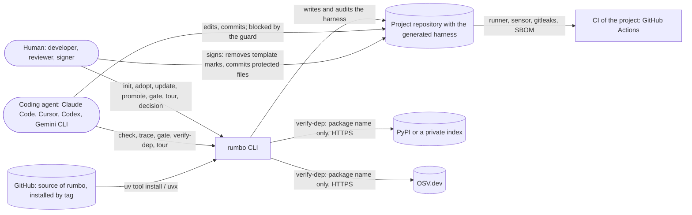
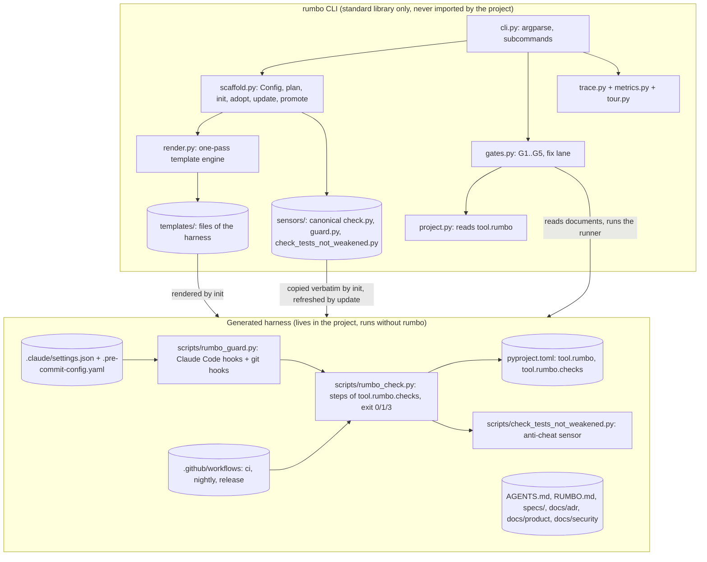

# Architecture (C4 levels 1–2)

RUMBO is a command-line tool and the harness it writes into other repositories. It runs on the
developer's machine and in the project's CI; it operates no service.

## Level 1 — Context

## Level 2 — Containers

## Notes
- **Layout**: `src/rumbo/` is a flat package (ADR-0010: `kind = cli`, `layout = flat`); there are
  no import-linter contracts. The architectural rule that matters is a boundary, not layers: the
  three scripts under `sensors/` are standalone and standard-library only, because they are
  copied into projects that do not have `rumbo` installed (ADR-0005, ADR-0006).
- **Two runtimes**: the CLI runs where it is installed; the harness runs inside every project,
  from the project's own virtual environment. `tests/test_self_adoption.py` keeps the copies in
  this repository identical to the canonical sources.
- **No server, no database, no model call**: state is the project's files and its git history.
- **Network**: only `rumbo verify-dep` (HTTPS to PyPI, OSV and an optional private index) and the
  installation of `rumbo` itself; the runner and the hooks are offline (ADR-0003).
- **Trust anchor**: the human. Template marks, protected files and signed ADRs/specs can only be
  changed by a human's edit and commit (ADR-0005, ADR-0008, ADR-0017).
