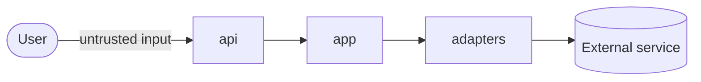

<!-- rumbo:template — delete this line when the document is complete. Only the HUMAN removes it; `rumbo gate` checks it. -->
# Threat model

## Data flow

## Assets

## Trust boundaries

## STRIDE per boundary
| Boundary | S | T | R | I | D | E |
|---|---|---|---|---|---|---|

## Lethal trifecta
<!-- Private data? Untrusted content? External communication? Which leg is removed, and how is that enforced (test/sensor)? -->
| Leg | Present in this system? | How it is removed or contained | Sensor |
|---|---|---|---|
| Private data | | | |
| Untrusted content | | | |
| External communication | | | |

## Mitigations (each with its test)
| Threat | Mitigation | Test |
|---|---|---|

## Accepted risks (signed by the human)
