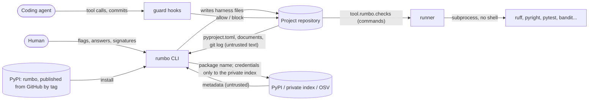

# Threat model

Scope: the `rumbo` CLI and the harness it writes into a project. One-hour model (2026-11-09),
revisited when a boundary changes; last revisited on 2026-11-21, after the second audit of
v0.4.0 and the internal audit of its fixes (`docs/audits/`). RUMBO calls no model; the agent it
constrains does.

## Data flow

## Assets
- The integrity of the harness in each project: runner, guard, sensor, CI, `pyproject.toml`.
- The human's signatures: template marks, the approval mark, gate decisions, signed ADRs/specs.
- The project's secrets (`.env`, CI secrets, index credentials) and its source code.
- The integrity of `rumbo` itself: the templates and canonical sensors every project receives.

## Trust boundaries
1. **Agent → repository** (the guard): the agent is capable and not trusted to follow prose.
2. **Repository content → CLI and runner**: `pyproject.toml`, documents and commit messages may
   be written by a contributor or an agent.
3. **Network → CLI**: index and OSV responses in `verify-dep`.
4. **Pull request → CI**: a branch can change workflows and scripts.
5. **Upstream → developer machine**: installing `rumbo` and the tools it adds with `uv`.

## STRIDE per boundary
| Boundary | S | T | R | I | D | E |
|---|---|---|---|---|---|---|
| 1. Agent → repository | Agent declares itself human (`rumbo.human`) or unsets its marker | Edits protected files, shadows the tool configuration (`ruff.toml`, `pytest.ini`), removes a template mark, creates a document that looks signed, rewrites a signed ADR, weakens tests, commits past the hook | Agent writes `[tests-change-approved]` as if the human had | Agent reads `.env` | A red Stop loop that never ends | Disables hooks (`--no-verify`, `core.hooksPath`, git configuration through `-c` or the environment), reaches the shell through a tool the hooks do not match, plants a program named like a tool |
| 2. Repository → CLI/runner | A project name or package that smuggles template or TOML syntax | A `tool.rumbo.checks` step that hides a shell pipeline | — | Commit messages rendered into the review guide (prompt injection of the reviewer) | A step that never returns | A step that runs with a shell |
| 3. Network → CLI | A typosquatted or freshly registered package | Malformed JSON or HTML from an index; a 200 answer that is not an index page | — | Index credentials printed, sent over plain `http`, or forwarded to another host by a redirect or a proxy | A slow, hanging or oversized answer | — |
| 4. Pull request → CI | — | A PR edits workflows, `scripts/` or pins an action to a mutable tag | — | A PR exfiltrates a model or PyPI credential | — | A workflow with write permissions |
| 5. Upstream → machine | A look-alike of `rumbo` or of a dev tool | A compromised release of a dependency | — | — | — | Code execution at install time |

## Lethal trifecta
<!-- Private data? Untrusted content? External communication? Which leg is removed, and how is that enforced (test/sensor)? -->
| Leg | Present in this system? | How it is removed or contained | Sensor |
|---|---|---|---|
| Private data | Yes: the CLI and the hooks read the repository; the agent can read source code | The generated permissions deny reading `.env*` and key files; the CLI never reads them | `tests/test_guard.py::test_generated_project_wires_the_guard` |
| Untrusted content | Yes: commit messages, documents, `pyproject.toml`, index responses | Treated as data: one-pass template rendering, names validated, steps run without a shell | `tests/test_render.py::test_substituted_values_are_not_expanded_again`, `tests/test_scaffold.py::test_invalid_names`, `tests/test_check.py::test_shell_operators_are_configuration_errors` |
| External communication | **Removed** from everything except `verify-dep`: the runner, the hooks and the gates are offline. `verify-dep` sends only a package name: over HTTPS to PyPI and OSV, and to the private index as it is configured (it may be plain `http`), with the credentials of that index going to that index alone (ADR-0028). The generated permissions deny `curl`/`wget` to the agent, the guard refuses `verify-dep --index` from an agent's shell, and CI holds no model credential | This is the leg that is cut | `tests/test_scaffold.py::test_ci_never_holds_the_model_credential`; `scripts/e2e.sh` runs the runner with every provider variable unset; `tests/test_cli.py::test_verify_dep_never_prints_the_index_credentials`; `tests/test_verify_dep.py::test_a_redirect_away_from_the_index_drops_the_credentials_for_good`; `tests/test_guard.py::test_bypass_spellings_are_blocked` |

## OWASP LLM / Agentic checklist
RUMBO is not an LLM application, so the LLM Top 10 applies to the projects it generates
(their threat-model template carries it). What applies to RUMBO as tooling **around** an agent:
- Excessive agency (LLM06 / agentic): contained by the guard and the permission deny list, not
  by prompts (ADR-0005, ADR-0008, ADR-0017).
- Prompt injection through repository content (LLM01): the review guide quotes commit messages;
  see "Accepted risks".
- Supply chain (LLM03): `verify-dep` before any new dependency; actions pinned by SHA.
- Sensitive information disclosure (LLM02): `.env*` unreadable by the agent; credentials never
  printed.

## Mitigations (each with its test)
| Threat | Mitigation | Test |
|---|---|---|
| Agent edits the harness or removes a signature | Guard blocks the edit, reports it after a shell command, refuses the commit | `tests/test_guard.py` (F-0001.R1–R4, R7, R13, R14) |
| Agent shadows the tool configuration, or edits `.git/` | The files that shadow `pyproject.toml` and the git directory are protected (ADR-0023) | `tests/test_guard.py::test_files_that_shadow_pyproject_are_protected`, `::test_the_git_directory_is_protected_and_its_neighbours_are_not` |
| Agent reaches the shell through another tool | Every shell tool is judged like Bash; the hook matchers name them | `tests/test_guard.py::test_every_shell_tool_is_judged_like_bash`, `::test_generated_project_wires_the_guard` |
| Agent commits past the `pre-commit` hook | The guard remembers `HEAD`: the commit is judged after the command, and Stop verifies committed code (ADR-0024) | `tests/test_guard.py::test_a_commit_that_skipped_the_hook_is_judged_after_the_command`, `::test_stop_verifies_code_committed_since_the_last_green_head` |
| Agent creates a document that looks signed | A numbered ADR or spec cannot be created without the template mark (ADR-0025) | `tests/test_guard.py::test_an_agent_cannot_create_a_numbered_document_without_the_mark` |
| Agent signs for the human | `commit-msg` hook refuses the approval mark; the sensor ignores approvals authored by agents | `tests/test_guard.py::test_commit_msg_refuses_the_approval_mark_from_an_agent`, `tests/unit/test_check_tests_not_weakened.py::test_end_to_end_with_git` |
| Agent finishes on red, or loops repairing a broken environment | Stop blocks on exit 1 once; exit 3 is reported to the human | `tests/test_guard.py` (F-0001.R5, R6) |
| Agent disables the hooks or declares itself human | Dangerous-command rules, judged on the command as the shell reads it (a flag on another line, a continuation) | `tests/test_guard.py::test_dangerous_commands_are_blocked`, `::test_bypass_spellings_are_blocked`, `::test_a_forbidden_flag_on_another_line_is_still_blocked` |
| Tests weakened to go green | AST sensor with helper resolution, in the runner and in CI with `--strict`: two counts per test (asserts written, asserts able to fail), skips counted where they reach an existing test, its settings read from the base (ADR-0026, ADR-0027) | `tests/test_sensor.py` |
| A program planted in the project is run in place of a tool | The runner never takes a program named without a directory from the project, nor from the current directory (ADR-0022) | `tests/test_check.py::test_a_program_named_without_a_directory_is_never_taken_from_the_project`, `::test_files_planted_in_the_project_root_are_not_run_in_place_of_the_tools` |
| The human's documents overwritten by `--force` | A backup is never overwritten; a file equal to the template is skipped (ADR-0029) | `tests/test_scaffold.py::test_force_never_overwrites_a_backup_and_skips_identical_files` |
| Template or TOML injection through a name | Names validated; values copied verbatim in one pass and escaped | `tests/test_scaffold.py::test_invalid_names`, `::test_name_is_escaped_in_toml_and_python`, `tests/test_render.py::test_substituted_values_are_not_expanded_again` |
| Shell injection through a check step | Split into words without a shell, shell operators rejected; a batch program refuses the arguments `cmd.exe` would interpret | `tests/test_check.py::test_shell_operators_are_configuration_errors`, `::test_a_batch_program_refuses_what_cmd_would_interpret` |
| Shell injection through the review guide | Every path and ref in a command of the guide is quoted | `tests/test_tour.py::test_paths_and_refs_are_quoted_in_the_commands_the_reviewer_will_paste` |
| Slopsquatting / typosquatting | `verify-dep`: existence, age, look-alike distance, OSV | `tests/test_cli.py::test_verify_dep_handles_bad_json_and_typos` |
| Malformed answer, or a page that is not an index | Every answer is untrusted: a 200 that is not a package page is "could not confirm" (exit 2), never "exists" | `tests/test_verify_dep.py::test_a_200_answer_that_is_not_a_package_page_does_not_confirm_the_name` |
| A slow, hanging or oversized answer | One request has a total deadline and a body cap (ADR-0028) | `tests/test_verify_dep.py::test_a_server_that_never_finishes_is_cut_by_the_deadline`, `::test_a_body_larger_than_the_cap_is_refused_and_one_cut_short_is_not_a_page` |
| Index credentials leaked | URLs sanitised before any output and a malformed value never echoed; never sent over plain `http` unless the index is on this machine; dropped on a redirect to another origin; a loopback index is reached without the proxies of the environment | `tests/test_cli.py::test_verify_dep_never_prints_the_index_credentials`, `tests/test_verify_dep.py::test_no_shape_of_an_index_value_prints_its_password`, `::test_index_credentials_are_never_sent_over_plain_http`, `::test_a_redirect_away_from_the_index_drops_the_credentials_for_good`, `::test_a_loopback_index_is_never_reached_through_the_proxy_of_the_environment` |
| A PR exfiltrates a credential | The check is offline; no model credential in the PR workflow; release by Trusted Publishing | `tests/test_scaffold.py::test_ci_never_holds_the_model_credential`, `tests/test_cli.py::test_release_template_uses_trusted_publishing_with_pinned_actions` |
| Compromise of RUMBO's own dependencies | Zero runtime dependencies | `tests/test_fitness.py::test_cli_has_no_runtime_dependencies` |
| Secrets committed | gitleaks as a pre-commit hook and as a full-history CI job | CI job `secrets` |

## Accepted risks (signed by the human)
- **An agent outside Claude Code can unset its marker or run with no marker we know.** Aider and
  Amp set none we could confirm; in a clone the human declared they are the human to the git
  hook, and only their commit attribution identifies them, in CI (ADR-0021). The git hooks rely
  on `rumbo.human` being unset (fail-closed), and `rumbo init` no longer sets it for an agent; a
  determined agent that sets it is breaking a rule, and CI plus CODEOWNERS are the binding layer.
- **Gemini CLI turns git hooks off in its own shell** (an empty hooks path through
  `GIT_CONFIG_*`; measured). The git hook never runs for it: CI and CODEOWNERS are its only
  binding layers. Candidate for a spec: a live hook through Gemini CLI's own hook system.
- **The review guide (`rumbo tour`) quotes commit messages and file names verbatim.** A hostile
  commit message could try to instruct the agent that reads the guide. Today the only
  mitigation is that the guide is for the human; no sensor. Candidate for a spec.
- **`rumbo` is published to PyPI by Trusted Publishing** (OIDC from `release.yml`, environment
  `pypi`, no token stored), since v0.4.0. A compromised GitHub account could still push a tag
  and publish; the `pypi` environment has no required reviewer while there is one maintainer.
- **The runner executes whatever `tool.rumbo.checks` says.** The table is a protected file, so
  only a human's commit changes it; a malicious contributor's PR that edits it is caught by
  review and CODEOWNERS, not mechanically. Since ADR-0019 the guard enforces it for agents: `pyproject.toml` is compared table by table
  and only its dependency tables may change without the human.
- **A private index may be plain `http`.** `verify-dep` accepts it for the index lookup (PyPI
  and OSV are HTTPS only); the package name travels in clear on that network. Credentials do
  not: over plain `http` they are sent only to an index on this machine.
- **What `verify-dep` still shows or leaves.** A token written in the path of an index URL,
  not in its user part, is printed. A request abandoned at its deadline lives in its thread
  until the process exits. The limits (60 s per request, 32 MB per answer) were not measured
  against PyPI.
- **The anti-cheat sensor reads the syntax, not the behaviour.** Asserts under a condition
  that is never true, a helper named like an assertion that checks nothing, a mock that
  empties the behaviour and a widened `pytest.raises` pass it (ADR-0027); mutation testing
  and review cover them. A push straight to the default branch is compared with the push
  before it, so a weakening shows once; and the push that follows a pull request approved by
  label is red once. Protect the branch and work through pull requests.
- **The memory of the guard is a file under the git directory** (ADR-0024). A shell can
  write it, although the guard refuses edits under `.git/` and reads an unreadable state as
  unknown. A commit made in the background after a command has ended is not judged until
  the next one. In a project that lives in a sub-directory of its repository the Claude Code
  hooks judge it, but the `pre-commit` hook reads paths from the repository root.
- **A project upgraded from an older harness keeps its `.claude/settings.json`.** `rumbo
  update` never rewrites it, so the hook matchers do not name PowerShell and two commands
  stay pre-approved (`make rumbo *`, `rumbo decision *`) until the human does what `rumbo
  doctor` says.
- **`[tool.rumbo].tests` names one top-level directory.** Tests found elsewhere in an adopted
  project are collected by pytest, but the sensor, `rumbo trace` and gate G4 do not watch
  them; `rumbo init` says so in its report.
