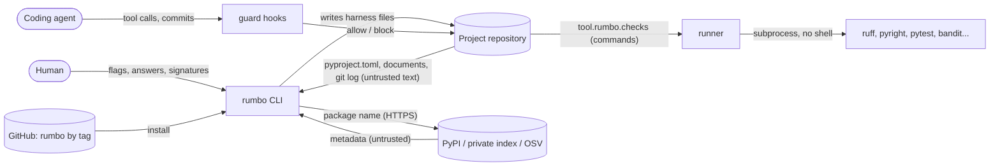

<!-- rumbo:template — delete this line when the document is complete. Only the HUMAN removes it; `rumbo gate` checks it. -->
# Threat model

Scope: the `rumbo` CLI and the harness it writes into a project. One-hour model (2026-11-09),
revisited when a boundary changes. RUMBO calls no model; the agent it constrains does.

## Data flow

## Assets
- The integrity of the harness in each project: runner, guard, sensor, CI, `pyproject.toml`.
- The human's signatures: template marks, the approval mark, gate decisions, signed ADRs/specs.
- The project's secrets (`.env`, CI secrets, index credentials) and its source code.
- The integrity of `rumbo` itself: the templates and canonical sensors every project receives.

## Trust boundaries
1. **Agent → repository** (the guard): the agent is capable and not trusted to follow prose.
2. **Repository content → CLI and runner**: `pyproject.toml`, documents and commit messages may
   be written by a contributor or an agent.
3. **Network → CLI**: index and OSV responses in `verify-dep`.
4. **Pull request → CI**: a branch can change workflows and scripts.
5. **Upstream → developer machine**: installing `rumbo` and the tools it adds with `uv`.

## STRIDE per boundary
| Boundary | S | T | R | I | D | E |
|---|---|---|---|---|---|---|
| 1. Agent → repository | Agent declares itself human (`rumbo.human`) or unsets its marker | Edits protected files, removes a template mark, rewrites a signed ADR, weakens tests | Agent writes `[tests-change-approved]` as if the human had | Agent reads `.env` | A red Stop loop that never ends | Disables hooks (`--no-verify`, `core.hooksPath`) |
| 2. Repository → CLI/runner | A project name or package that smuggles template or TOML syntax | A `tool.rumbo.checks` step that hides a shell pipeline | — | Commit messages rendered into the review guide (prompt injection of the reviewer) | A step that never returns | A step that runs with a shell |
| 3. Network → CLI | A typosquatted or freshly registered package | Malformed JSON or HTML from an index | — | Index credentials printed in output or logs | A slow or hanging endpoint | — |
| 4. Pull request → CI | — | A PR edits workflows, `scripts/` or pins an action to a mutable tag | — | A PR exfiltrates a model or PyPI credential | — | A workflow with write permissions |
| 5. Upstream → machine | A look-alike of `rumbo` or of a dev tool | A compromised release of a dependency | — | — | — | Code execution at install time |

## Lethal trifecta
<!-- Private data? Untrusted content? External communication? Which leg is removed, and how is that enforced (test/sensor)? -->
| Leg | Present in this system? | How it is removed or contained | Sensor |
|---|---|---|---|
| Private data | Yes: the CLI and the hooks read the repository; the agent can read source code | The generated permissions deny reading `.env*` and key files; the CLI never reads them | `tests/test_guard.py::test_generated_project_wires_the_guard` |
| Untrusted content | Yes: commit messages, documents, `pyproject.toml`, index responses | Treated as data: one-pass template rendering, names validated, steps run without a shell | `tests/test_render.py::test_substituted_values_are_not_expanded_again`, `tests/test_scaffold.py::test_invalid_names`, `tests/test_check.py::test_shell_operators_are_configuration_errors` |
| External communication | **Removed** from everything except `verify-dep`: the runner, the hooks and the gates are offline, and `verify-dep` sends only a package name over HTTPS. The generated permissions deny `curl`/`wget` to the agent, and CI holds no model credential | This is the leg that is cut | `tests/test_scaffold.py::test_ci_never_holds_the_model_credential`; `scripts/e2e.sh` runs the runner with every provider variable unset; `tests/test_cli.py::test_verify_dep_never_prints_the_index_credentials` |

## OWASP LLM / Agentic checklist
RUMBO is not an LLM application, so the LLM Top 10 applies to the projects it generates
(their threat-model template carries it). What applies to RUMBO as tooling **around** an agent:
- Excessive agency (LLM06 / agentic): contained by the guard and the permission deny list, not
  by prompts (ADR-0005, ADR-0008, ADR-0017).
- Prompt injection through repository content (LLM01): the review guide quotes commit messages;
  see "Accepted risks".
- Supply chain (LLM03): `verify-dep` before any new dependency; actions pinned by SHA.
- Sensitive information disclosure (LLM02): `.env*` unreadable by the agent; credentials never
  printed.

## Mitigations (each with its test)
| Threat | Mitigation | Test |
|---|---|---|
| Agent edits the harness or removes a signature | Guard blocks the edit, reports it after a shell command, refuses the commit | `tests/test_guard.py` (F-0001.R1–R4, R7, R13, R14) |
| Agent signs for the human | `commit-msg` hook refuses the approval mark; the sensor ignores approvals authored by agents | `tests/test_guard.py::test_commit_msg_refuses_the_approval_mark_from_an_agent`, `tests/unit/test_check_tests_not_weakened.py::test_end_to_end_with_git` |
| Agent finishes on red, or loops repairing a broken environment | Stop blocks on exit 1 once; exit 3 is reported to the human | `tests/test_guard.py` (F-0001.R5, R6) |
| Agent disables the hooks or declares itself human | Dangerous-command rules | `tests/test_guard.py::test_dangerous_commands_are_blocked` |
| Tests weakened to go green | AST sensor with helper resolution, in the runner and in CI with `--strict` | `tests/test_sensor.py` |
| Template or TOML injection through a name | Names validated; values copied verbatim in one pass and escaped | `tests/test_scaffold.py::test_invalid_names`, `::test_name_is_escaped_in_toml_and_python`, `tests/test_render.py::test_substituted_values_are_not_expanded_again` |
| Shell injection through a check step | `shlex` split, `shell=False`, shell operators rejected | `tests/test_check.py::test_shell_operators_are_configuration_errors` |
| Slopsquatting / typosquatting | `verify-dep`: existence, age, look-alike distance, OSV | `tests/test_cli.py::test_verify_dep_handles_bad_json_and_typos` |
| Index credentials leaked | URLs sanitised before any output | `tests/test_cli.py::test_verify_dep_never_prints_the_index_credentials` |
| A PR exfiltrates a credential | The check is offline; no model credential in the PR workflow; release by Trusted Publishing | `tests/test_scaffold.py::test_ci_never_holds_the_model_credential`, `tests/test_cli.py::test_release_template_uses_trusted_publishing_with_pinned_actions` |
| Compromise of RUMBO's own dependencies | Zero runtime dependencies | `tests/test_fitness.py::test_cli_has_no_runtime_dependencies` |
| Secrets committed | gitleaks as a pre-commit hook and as a full-history CI job | CI job `secrets` |

## Accepted risks (signed by the human)
- **An agent outside Claude Code can unset its marker or run with no marker we know.** The git
  hooks then rely on `rumbo.human` being unset (fail-closed); a determined agent that sets it is
  breaking a rule, and CI plus CODEOWNERS are the binding layer (ADR-0008).
- **The review guide (`rumbo tour`) quotes commit messages and file names verbatim.** A hostile
  commit message could try to instruct the agent that reads the guide. Today the only
  mitigation is that the guide is for the human; no sensor. Candidate for a spec.
- **`rumbo` is installed from a git tag, not yet from PyPI with attestations.** A compromised
  GitHub account could move a tag. Mitigation planned: Trusted Publishing once G1 is signed.
- **The runner executes whatever `tool.rumbo.checks` says.** The table is a protected file, so
  only a human's commit changes it; a malicious contributor's PR that edits it is caught by
  review and CODEOWNERS, not mechanically.
- **A private index may be plain `http`.** `verify-dep` accepts it for the index lookup (PyPI
  and OSV are HTTPS only); the package name travels in clear on that network.
