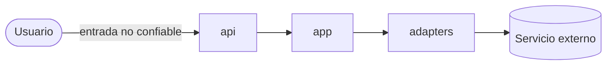

<!-- rumbo:plantilla — borra esta línea cuando el documento esté completo (lo verifica `rumbo gate`) -->
# Threat model

## Flujo de datos

## Activos

## Fronteras de confianza

## STRIDE por frontera
| Frontera | S | T | R | I | D | E |
|---|---|---|---|---|---|---|

## OWASP LLM 2025 / Agentic 2026 aplicables

## Trifecta letal
<!-- ¿Datos privados? ¿Contenido no confiable? ¿Comunicación externa? ¿Qué pata se elimina y cómo? -->

## Mitigaciones (cada una con su test)
| Amenaza | Mitigación | Test |
|---|---|---|

## Riesgos aceptados (firmados por el humano)
